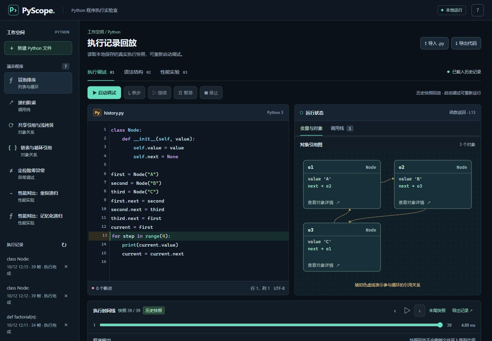
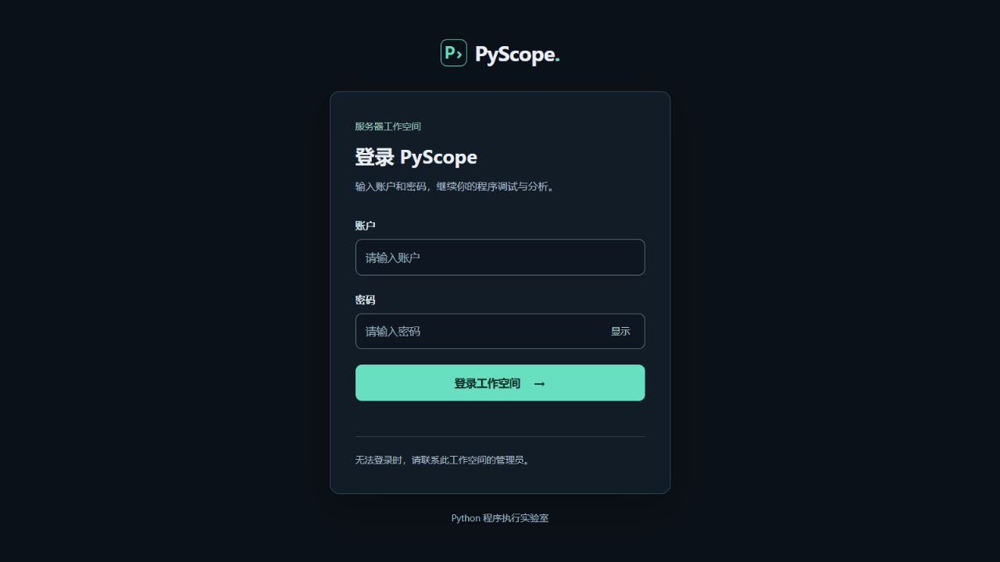

# PyScope

**基于 Python 的程序执行可视化与调试分析平台**

在本地浏览器编辑 Python 代码，真正暂停、单步或按断点运行，并同时观察变量、对象引用、调用栈、输出和执行历史。项目还提供 AST 结构分析、函数性能统计以及 SQLite 历史记录。



## 下载与服务器运行

[GitHub Releases](https://github.com/1911661808-code/PyScope/releases) 提供完整作业包，包含 Windows 免安装版、源码、选题材料、项目报告和答辩 PPT。仓库保留可直接浏览的源码与材料，Windows 运行时随发行压缩包提供。

**v1.1.0 已补充服务器登录和 Docker 执行隔离。** 账号由管理员创建，密码使用 scrypt 哈希；所有执行接口需要登录与 CSRF 校验，运行会话和历史记录按账号隔离。代码调试、性能分析和 AST 解析均在独立受限容器中完成。

腾讯云没有域名也能部署：优先通过 SSH 隧道访问登录页。完整步骤见 [服务器安装与启动](deploy/README.md) 和 [服务器部署与安全边界](docs/服务器部署与安全边界.md)。服务器要求 Linux 非 root 账号、rootless Docker、有效的 cgroup v2 限制；检查失败拒绝启动。若要通过公网浏览器直接访问，还需可信 HTTPS 证书。没有默认密码，也没有公开注册。



Windows 免安装版仍以本地模式运行。服务器新增入口为 `server.py`，依赖安装使用 `requirements-server.txt`；不要通过修改 `app.py` 的监听地址将本地模式暴露到公网。Docker 共享宿主内核，本项目面向受控账号，不承诺匿名任意代码执行平台的安全性。

## 直接运行 Windows 免安装版

打开交付包中的 `Windows免安装版/PyScope/PyScope.exe`，无需另行安装 Python。保留整个 `PyScope` 文件夹，程序依赖旁边的 `_internal` 资源目录。程序启动后打开本地浏览器；运行数据保存在可执行文件旁的 `data` 目录。

免安装版已完成 12 项 HTTP 集成验证，包括调试控制、中文输出、标准库调用、AST、性能分析、异常、跨源拒绝、历史保存与重启恢复删除，以及 9 份模板与静态资源的一致性。

## 启动源码版

需要 Python 3.10 或更新版本。本次实际测试使用 Windows 11、Python 3.12.14、Flask 3.1.3。

Windows 用户双击项目目录中的 `start.bat`。脚本会创建项目内的 `.venv`，检查并安装 Flask，然后启动服务。打开浏览器访问：

```text
http://127.0.0.1:8765
```

首次安装依赖需要联网。完成安装后，界面、编辑器和字体资源均由本地项目提供，不依赖 CDN。运行期间保留启动窗口；停止服务时在窗口按 `Ctrl+C`。

也可以在项目目录使用 PowerShell 手动启动：

```powershell
py -3 -m venv .venv
.\.venv\Scripts\python.exe -m pip install -r requirements.txt
.\.venv\Scripts\python.exe app.py --open
```

端口冲突时使用 `app.py --port 8766 --open`。服务只监听 `127.0.0.1`，不会自动部署到公网。

## 推荐演示顺序

1. 选择“共享引用与浅拷贝”，点击开始调试，单步观察外层复制与内层共享。
2. 选择“递归阶乘”，在递归调用所在行设置断点，继续执行并切换调用栈帧。
3. 拖动历史时间轴，比较某次修改前后的变量与对象状态。
4. 查看 AST，比较静态函数定义数量和动态递归调用层数。
5. 分别选择两个性能示例进行独立性能分析，比较输出和函数调用次数。
6. 运行至结束，导出 JSON 执行记录，然后从本地历史重新载入。

“性能对比：重复递归”会产生大量执行事件，推荐直接使用性能分析，不要用完整逐行调试跑大输入。

## 功能与语义

| 功能 | 行为 |
| --- | --- |
| 代码编辑 | 本地 CodeMirror 5 编辑器，支持 `.py` 导入与导出 |
| 首行暂停 | 停在首个可执行行，等待控制命令 |
| 单步 | 运行到下一可执行行，可进入函数调用 |
| 断点与继续 | 在设置的可执行行执行前暂停 |
| 变量与栈帧 | 展示当前或选中栈帧的局部变量 |
| 对象关系 | 容器和用户对象使用会话内对象标识，支持别名与循环引用 |
| 历史回放 | 切换已保存状态，查看过去事件 |
| AST | 展示语法树及函数、类、分支、循环计数 |
| 性能分析 | 独立重执行当前代码并收集 cProfile 函数统计 |
| 历史与导出 | SQLite 保存最近 100 次已结束会话，支持载入、删除和 JSON 导出 |

**“即将执行 · Lx”表示 line 事件执行前的位置。** 赋值后的变量变化在后续快照中出现；“异常事件”和“函数返回”标记对应事件发生位置，不能统一理解为下一行尚未执行。

**回放是查看已保存快照。** 它不会恢复活跃解释器，也不会撤销文件写入或其他外部副作用。性能分析会重新执行代码，耗时统计与调试会话分开。

## 支持范围与默认限制

**本地模式：**只运行自己信任的、单进程、单线程同步教学代码。本地子进程用于管理暂停、停止和超时，被执行代码仍具有当前用户的文件和网络权限。

**服务器模式：**每次执行使用无网络、只读根文件系统、非 root、移除 capabilities、禁止提权的独立容器，默认 128 MiB 内存、0.5 CPU、32 个进程。启动探针读取实际 cgroup 状态；指定 runtime 不可用时不降级。服务最多同时保留 4 个活跃调试会话，每账号 2 个，另限 4 个并发分析请求；内存缓存最多保留 4 个已结束会话，单会话协议总量最多 8,000,000 字符。持久化历史每账号最多 100 条、全局最多 1,000 条，并在总 payload 超过 128 MiB 时淘汰最旧记录。通信大小不是宿主进程 RSS 的硬限制。具体配置与局限见服务器说明。

| 项目 | 默认值或行为 |
| --- | --- |
| Web 提交代码 | 最多 30,000 个字符 |
| 一次调试事件 | 最多 1,500 个 |
| 调试输出 | 最多 16,000 个字符，超过后停止 |
| 对象展开深度 | 最多 5 层 |
| 单个容器显示成员 | 最多 30 项 |
| 单帧显示对象 | 最多 120 个 |
| 会话对象注册表 | 最多 6,000 个对象 |
| 调用栈深度 | 最多 80 层 |
| 调试有效执行时间 | 30 秒，暂停查看时间不计入 |
| 会话总保留时间 | 30 分钟 |
| 同时活跃会话 | 最多 8 个 |
| 性能子进程超时 | 10 秒 |
| AST 展示 | 最多 350 个节点、12 层展开 |
| 持久化历史 | 最近 100 次已结束运行 |

以上限制可在相应模块中调整。对象展示会截断深层或过长内容，完整快照也不是任意 Python 对象的完整序列化。

对象注册表会保留有限的强引用以稳定对象编号，可能延长对象存活时间；调试快照不用于精确测量垃圾回收时机或内存占用。

当前版本不支持交互式 `input()`，请把输入直接设置为变量。多线程、多进程、异步调度、生成器完整调试、原生扩展内部逐行跟踪和多文件源码映射不在本次支持范围内。暂停请求需要等到下一个可跟踪位置，阻塞调用可使用停止结束。

## 数据文件

源码版默认在项目 `data/history.sqlite3` 保存历史记录。`PYSCOPE_DATA_DIR` 环境变量可以覆盖数据目录。记录包括执行的源码和快照；删除界面中的历史项会删除该条持久化记录。

导出的 JSON 使用 `pyscope-trace-v1` 格式，包含源码、断点、状态和事件。它用于留存与分析，不会作为代码自动执行。对象编号只在同一次运行中有意义。

## 自动验证

在项目目录运行：

```powershell
.\.venv\Scripts\python.exe -X utf8 -m unittest discover -s tests -v
```

原有 33 项 API 与引擎检查保留。v1.1.0 增加 10 项认证/授权检查、20 项执行边界检查，以及 6 项必须显式启用的真实 Docker 集成检查。Windows 无 Docker 时，容器检查明确跳过；GitHub Actions 分别在普通 Docker 和 rootless Docker 上构建镜像并验证真实隔离、资源限制、调试控制和容器清理。[查看 CI 结果](https://github.com/1911661808-code/PyScope/actions)。认证单测使用显式替代后端，不能作为容器验证证据。

性能实验数据保存在 `docs/benchmark_results.json`。相同输入 `fibonacci(22)` 下，两种实现均输出 `17711`。重复递归函数调用 57,313 次，记忆化递归调用 43 次。每种实现运行 5 次，包含 cProfile 开销的代码执行时间中位数分别为 6.7365 ms 与 0.0719 ms；该时间不包含进程启动，不能当作其他机器上的性能保证。

## 界面与键盘操作

宽窗口并排显示源码和运行状态；宽度不超过 760 px 时，顶部“工作空间”打开全部示例和执行记录。长代码、状态面板与性能表在各自区域滚动。

标签组支持左右方向键、Home 与 End。对象图节点支持 Enter 或空格展开；Escape 关闭对象详情、断点面板或工作空间并恢复焦点。窄屏侧栏展开时，键盘焦点保留在侧栏操作范围内。

本轮已实测 1440×1000、390×844 和 320×780 视口以及主要调试路径。设计依据见 `docs/界面设计说明.md`，具体证据与验证范围见 `docs/界面验收.json`。

## 项目结构

```text
PyScope/
  app.py                  Flask API 与 SQLite 历史
  session_manager.py      调试会话与进程生命周期
  auth.py                 服务器登录、会话、CSRF 与限流
  server.py               配置初始化、账号管理、预检与 Waitress 启动
  execution_backend.py    本地/容器后端与不可信协议校验
  sandbox/                隔离 worker 镜像与 AST 入口
  deploy/                 rootless Docker、systemd、SSH/HTTPS 部署模板
  trace_worker.py         执行跟踪与对象快照
  analysis_engine.py      AST 分析
  profile_worker.py       独立性能分析
  examples.py             教学示例
  templates/              页面模板
  static/                 界面和本地前端资源
  tests/                  引擎与 API 检查
  docs/                   设计说明、参考与验证资料
  提交材料/               项目报告和答辩文件
  requirements.txt        Python 依赖
  start.bat               Windows 启动脚本
```

## 常见问题

- `py` 无法识别：安装 Python 并启用 Python Launcher，或使用已有 Python 的完整路径创建虚拟环境。
- 页面无法连接：确认启动窗口没有关闭，检查地址与端口是否正确。
- 断点没有暂停：断点应位于实际执行到的代码行；注释、空行和未进入的分支不会触发。
- 变量没有立即改变：当前高亮行尚未执行，继续单步查看下一快照。
- 历史列表没有当前程序：程序需要进入完成、异常、停止或限制等结束状态，等待后台归档后刷新历史列表。
- 性能面板没有函数：纯顶层代码没有用户函数统计，可定义并调用函数后再次分析。
- 执行达到限制：缩小输入，或使用性能分析观察较大规模程序。

## 技术来源

核心基础来自 Python 标准库、Flask 与 CodeMirror。正式参考资料见 `docs/技术参考.md`，前端组件许可证随本地资源保留。项目展示和报告中的统计以真实运行结果为准。
