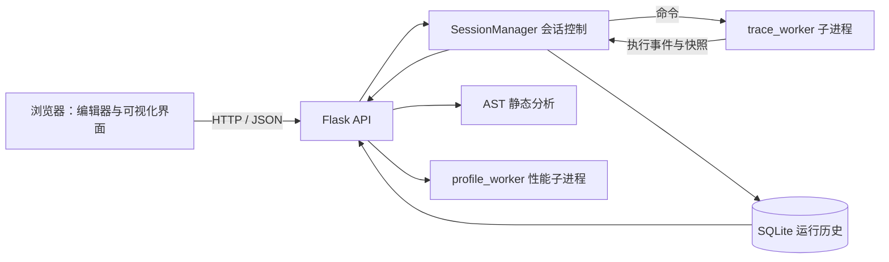
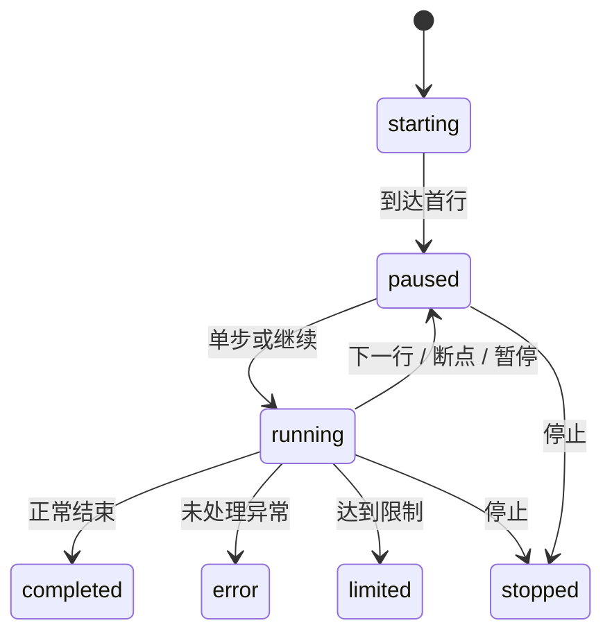

# PyScope 设计说明

项目题名：基于 Python 的程序执行可视化与调试分析平台  
课程：Python 语言程序设计  
姓名、学号、班级、组号、组长、小组成员：由提交人填写  
运行环境与验证记录见 README 及 `docs/benchmark_results.json`。

## 1. 选题背景与目标

学习 Python 时，源代码与输出结果之间存在一个不易观察的过程：变量在什么时候改变，函数返回前有哪些局部变量，两个名字是否引用同一个列表，递归为何会不断增加调用层级。只看最终输出往往无法解释这些问题；临时添加大量 `print` 又会改变程序文本，并让观察信息分散在多处。

PyScope 面向这一教学场景，把真实 Python 执行事件转换成可以观察、暂停和回看的状态。使用者在本地浏览器中编辑代码，控制后台 Python 解释器单步运行，同时查看代码位置、变量、对象引用、调用栈和标准输出。静态结构分析帮助理解程序的组成，独立性能分析帮助定位函数层面的耗时。

项目采用纯软件方案，不依赖外部硬件、在线大模型或云服务。运行需要本地 Python 环境和浏览器。核心工作是执行控制、状态建模、视图同步与实验验证。

## 2. 需求与验收依据

| 编号 | 用户需求 | 可观察的验收依据 |
| --- | --- | --- |
| F01 | 编辑、导入、导出 Python 代码 | 能载入 `.py`，修改后导出，中文内容保持一致 |
| F02 | 真正按行单步执行 | 程序停在首个可执行行；点击单步后才推进执行 |
| F03 | 设置断点并继续运行 | 在指定可执行行之前暂停，可再次继续 |
| F04 | 查看局部变量与调用栈 | 递归示例出现多个栈帧，选择栈帧后显示相应局部变量 |
| F05 | 查看对象引用 | 两个名字引用同一列表时指向同一对象标识；复制后的列表拥有不同标识 |
| F06 | 回看历史执行状态 | 拖动时间轴可查看过去快照，既有快照不会随后续修改改变 |
| F07 | 查看语法结构 | AST 展示节点层级；语法错误给出位置和错误说明 |
| F08 | 查看函数性能统计 | 返回调用次数、自身耗时与累计耗时，并保留运行输出 |
| F09 | 保存与管理运行记录 | 完成的会话可在重启后读取，支持 JSON 导出与记录删除 |
| F10 | 处理异常和过长运行 | 能显示程序异常，并在事件数、输出量或时间达到边界时结束运行 |

非功能需求包括：前端资源本地加载；界面操作提供进行中、成功和错误状态；服务只绑定本机地址；支持可信的单进程、单线程同步程序；日志与报告能够区分设计目标和实测结果。

## 3. 总体架构

系统分为浏览器交互层、Flask API 层、执行分析层和本地数据层。

浏览器负责呈现数据与发出命令，不模拟 Python 语义。API 将请求转换成会话操作，并对参数和语法错误返回明确响应。调试子进程执行用户代码并采集运行时事件。独立的性能子进程重新运行代码，以避免把人工暂停时间和快照构建开销当成程序性能。SQLite 持久化终态会话，运行历史保留数量按实现约定限制为最近 100 次。

### 3.1 模块职责

| 模块 | 主要职责 | 设计原因 |
| --- | --- | --- |
| `app.py` | HTTP 路由、请求校验、历史读写与下载 | 统一对外协议，避免视图直接接触执行进程 |
| `session_manager.py` | 会话状态、事件缓存、命令转发、进程生命周期 | 将会话管理与具体跟踪逻辑分开 |
| `trace_worker.py` | 执行跟踪、断点检查、状态采集、输出记录 | 真正控制被调试程序的推进 |
| `analysis_engine.py` | AST 转换、结构计数、静态提示 | 无需运行代码即可分析其语法结构 |
| `profile_worker.py` | 独立性能执行与统计整理 | 避免将调试暂停计入性能统计 |
| `examples.py` | 教学示例与说明 | 保证演示过程可重复 |
| `templates/`、`static/` | 编辑器、可视化、交互状态与本地资源 | 支持无 CDN 的本地演示 |
| `tests/` | 引擎和 API 行为检查 | 对执行语义及边界进行回归验证 |

### 3.2 数据流

一次调试从提交代码开始。后端创建会话，启动工作进程，工作进程在首个可执行行之前暂停。前端按事件索引请求增量数据，避免每次都传输完整历史。每个新事件形成不可变的展示快照；浏览器通过当前选中索引刷新代码位置、栈帧、变量、对象图和输出。程序结束后，完整会话进入本地历史。

## 4. 核心机制

### 4.1 执行事件与单步语义

`sys.settrace` 为 Python 执行提供 `call`、`line`、`return`、`exception` 等事件。系统只收集目标代码范围内的事件，减少框架与标准库细节造成的噪声。[Python 官方执行跟踪文档](https://docs.python.org/3/library/sys.html#sys.settrace)

`line` 事件发生在对应源码行执行之前。因此，当界面高亮 `x = 3` 时，变量面板可能仍未出现 `x`；下一次单步执行后才应看到赋值结果。这个时序是调试器设计的一部分，不能将高亮理解为“这行已经执行完”。

本项目的“单步”推进到下一个可执行行，会进入被调用函数；它不是“跳过函数”的 step-over。继续运行在下一处断点或程序终态停止。暂停请求在解释器返回可跟踪位置时生效，正在进行的阻塞调用可能无法立即响应；停止由会话管理层结束工作进程。

### 4.2 会话状态

主要状态包括 `starting`、`running`、`paused`、`completed`、`error`、`stopped` 和 `limited`。后三类结束状态分别对应异常、主动停止及资源边界。前端根据会话状态决定按钮是否可用，避免在完成的会话上继续发送单步命令。

### 4.3 变量、对象与循环引用

快照将值分为直接值与引用值。整数、布尔等可以直接显示；列表、字典等容器和用户对象使用会话内对象标识表示，再在对象表中保存有限深度的成员关系。变量区保存“名字指向哪个对象”，对象区保存“对象包含哪些值或引用”。

例如 `a = [1, 2]`、`b = a`、`c = a.copy()` 中，`a` 和 `b` 应共享同一标识，`c` 则有另一标识。随后执行 `b.append(3)`，`a` 和 `b` 可观察到同一对象内容变化，`c` 不受影响。

循环引用要求序列化过程中先登记对象，再继续访问其成员；遇到已经访问的对象时记录引用，不能无限展开。快照的对象数量、容器元素和文本长度需要设限，以控制体积。对象标识只用于同一次运行的展示，不等价于 Python 内存地址，也不能跨会话比较。

实际实现采用会话级 `ObjectRegistry` 保存对象与稳定编号的映射，并保留有限的强引用，避免对象回收后内存地址被复用而混淆身份。每次 `Snapshot` 使用独立的已访问集合生成对象记录。这样可以保持编号稳定，但也会延长已记录对象的存活时间，因此必须限制注册表容量，不能把调试中的对象生命周期当成未调试时的精确内存行为。

若一帧内可展示的变量数量为 A，对象数量为 V，成员引用数量为 E，则在值文本长度受限的条件下，快照遍历主要随 A、V、E 的总规模增长。保存 K 个完整快照会累积相应存储开销。本版本通过事件数、对象数、成员数和展开深度控制规模，尚未实现增量快照压缩。

### 4.4 历史回放

事件记录同时包含代码位置、栈帧、变量、对象、输出和时间信息。回放时只切换已保存的事件快照，不重新执行用户程序，也不让解释器返回过去的指令位置。因此，文件写入、网络请求或其他外部副作用不会被撤销。该功能应称为执行历史回放，而不能宣称实现任意程序的可逆调试。

### 4.5 AST 分析

AST 模块使用 Python 自带语法解析器，将代码转换为树，再构造可展示的节点标签、源码行号与子节点。结构计数包括函数、类、分支与循环等，具体口径应在界面中保持一致。AST 表示代码语法结构；它不能直接证明运行次数，也不能自动得出任意程序的时间复杂度。[Python 官方 AST 文档](https://docs.python.org/3.12/library/ast.html)

### 4.6 性能分析

性能入口重新执行当前代码，使用 `cProfile` 与 `pstats` 产生函数统计。自身耗时不包含下级函数调用，累计耗时包含；递归程序的调用次数需要与其调用结构一同理解。性能结果用于定位热点，单次测量受解释器版本、系统负载和输入规模影响，不应当成严格基准。[Python 官方性能分析文档](https://docs.python.org/3.12/library/profile.html)

## 5. 接口与存储设计

| 接口 | 输入或用途 | 主要输出 |
| --- | --- | --- |
| `GET /api/examples` | 获取示例 | 示例编号、名称、说明、代码 |
| `POST /api/analyze` | 代码文本 | AST、结构统计、静态提示 |
| `POST /api/sessions` | 代码、断点行号 | 新建会话与初始状态 |
| `GET /api/sessions/<id>?after=n` | 会话与已知事件索引 | 新增事件及当前状态 |
| `POST /api/sessions/<id>/command` | `step/run/pause/stop` | 更新后的会话状态 |
| `GET /api/sessions/<id>/export` | 会话编号 | 完整 JSON 记录 |
| `POST /api/profile` | 当前代码 | 函数统计、输出、异常信息 |
| `GET /api/history` | 查询历史 | 历史摘要列表 |
| `GET /api/history/<id>` | 历史编号 | 完整执行记录 |
| `DELETE /api/history/<id>` | 历史编号 | 删除结果 |

SQLite 适合本地单用户项目：无需安装独立数据库服务器，可将结构化元信息与完整 JSON 快照存入文件。序列化和反序列化应使用明确的 JSON 协议，避免读取历史记录时执行其中内容。[Python 官方 sqlite3 文档](https://docs.python.org/3.12/library/sqlite3.html)

## 6. 工程边界

本地工作进程改善了界面与执行代码之间的生命周期分离，使停止和超时处理成为可能，但它没有提供操作系统级安全隔离。被执行代码仍可能访问当前用户权限范围内的文件和网络。系统只用于可信代码，服务不应对外网开放。[Python 官方 subprocess 文档](https://docs.python.org/3/library/subprocess.html)

当前设计支持单文件入口、单进程、单线程同步教学程序。多线程调试、异步任务完整调度、多进程树管理、原生扩展内部逐行跟踪、实时外部输入与真正逆向执行均不作为完成承诺。AST 解析能力与当前解释器支持的语法一致。

## 7. 验证方案

引擎检查重点不是按钮能否点击，而是执行语义是否正确：首行是否执行前暂停；单步是否真的推进；断点是否停在约定时刻；旧快照是否保持原值；别名和循环引用是否被正确编码；异常是否保留执行上下文；结束后进程是否回收。

API 检查覆盖有效请求、语法错误、未知会话、非法命令、导出格式和历史保存。界面检查覆盖示例加载、断点、栈帧切换、时间轴、AST、性能面板、历史载入和错误提示。

2026 年 10 月 12 日在 Windows 11、Python 3.12.14 与 Flask 3.1.3 环境运行 `python -X utf8 -m unittest discover -s tests -v`，33 项自动检查通过，其中引擎 23 项、API 10 项，用时 14.949 秒。该结果证明所列自动检查通过，浏览器交互仍需结合单独的界面检查记录评估。

性能实验对 `fibonacci(22)` 的两个实现各执行 5 次。两者均输出 `17711`，重复递归函数调用 57,313 次，记忆化递归调用 43 次。包含 cProfile 开销的代码执行时间中位数分别为 6.7365 ms 与 0.0719 ms，不含进程启动时间，原始逐次数据保存在 `docs/benchmark_results.json`。计时随机器与负载变化，调用次数与输出一致性是解释此次差异的主要证据。

## 8. 项目特色与可解释性

本项目将执行事件、状态快照和多个可视化视图统一到同一条时间轴。可见效果来自真实运行数据，而非预设动画。对象别名与循环引用、执行前暂停语义、调试与性能分离是实现中需要解决的关键问题。

对于课程答辩，最有价值的证据是完整演示一段程序从源代码到运行状态再到错误解释的过程，并能指出框架提供的能力与项目自己实现的控制逻辑。后续可以扩展条件断点、更细粒度的快照存储以及多文件源码映射，但应在完成现有语义验证后再开展。
